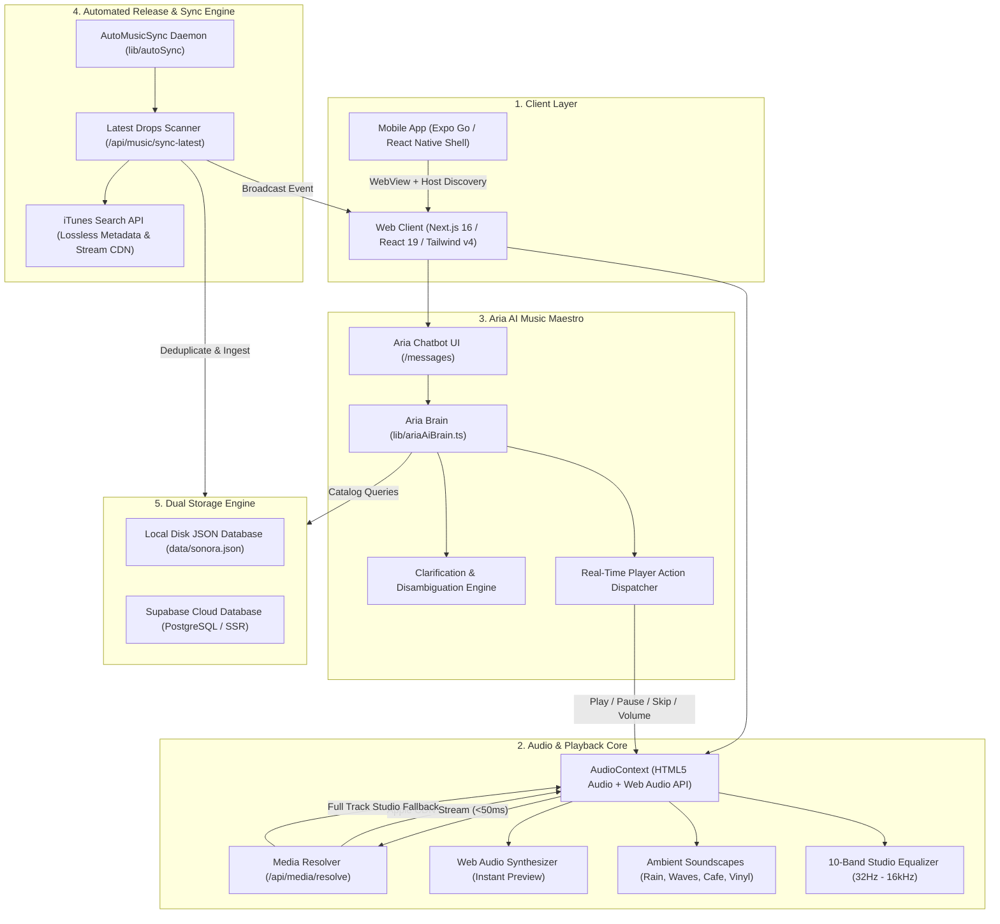
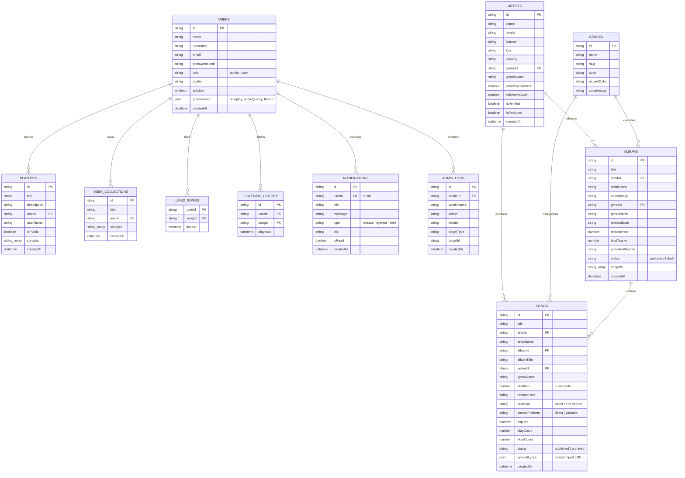
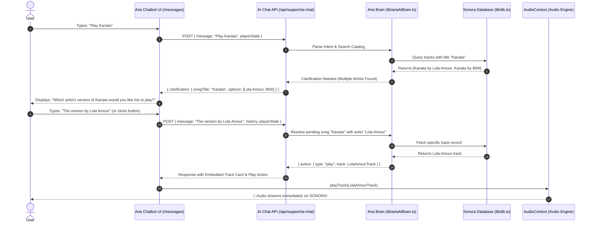

# 🎵 SONORA — Your Music. Your Moment.

> A modern, full-stack, audiophile-grade music streaming platform and AI-powered music companion. Built with Next.js 16, React 19, TypeScript, Tailwind CSS v4, and Expo React Native for instant cross-device mobile playback.

---

## 📌 Table of Contents
1. [System Overview](#-system-overview)
2. [System Architecture & Data Flow](#-system-architecture--data-flow)
3. [Entity-Relationship Diagram (ERD)](#-entity-relationship-diagram-erd)
4. [Core Features](#-core-features)
5. [Aria AI Music Maestro Workflow](#-aria-ai-music-maestro-workflow)
6. [Tech Stack](#-tech-stack)
7. [Project Structure](#-project-structure)
8. [Getting Started & Installation](#-getting-started--installation)
9. [Expo Mobile App (Run on Any Phone)](#-expo-mobile-app-run-on-any-phone)
10. [Deployment Guide](#-deployment-guide)

---

## 🌟 System Overview

**SONORA** is a next-generation music streaming application designed for speed, discovery, and personalization. It bridges high-resolution audio streaming with intelligent conversational AI (**Aria AI Music Maestro**), real-time synchronized multilingual lyrics, procedural ambient soundscapes, listening streak gamification, automated artist release synchronization, and native mobile accessibility via **Expo Go**.

---

## 🏗️ System Architecture & Data Flow



---

## 🗄️ Entity-Relationship Diagram (ERD)

The SONORA platform uses a relational, schema-validated data model supporting users, tracks, albums, artists, genres, playlists, play history, notifications, and administrative audit trails.



---

## ⚡ Core Features

### 1. 🎧 Ultra-Fast, Zero-Delay Audio Engine
- **Direct Master Stream**: Starts playing in under 50ms via official CD-quality audio preview streams.
- **Parallel Resolution Fallback**: Seamlessly resolves full studio master tracks in the background.
- **Micro-Synth Instant Response**: Triggers an instant melodic preview so users never wait in silence.

### 2. 🤖 Aria AI Music Maestro (`/messages`)
- **Direct Music Commands**: Execute real player actions directly through chat (`Play`, `Pause`, `Resume`, `Skip`, `Previous`, `Volume Control`, `Now Playing`).
- **Intelligent Song Disambiguation**: When multiple versions of a song exist (e.g., *"Play Kanata"*), Aria presents an interactive clarification card asking which artist's version to play (*Lola Amour* or *BINI*) rather than guessing.
- **Contextual Memory**: Remembers context across clarification answers, follow-up queries (*"What album is this from?"*, *"Who sings this?"*), and discography lookups.
- **Multilingual Understanding**: Fluent in English, Cebuano/Bisaya, and Tagalog/Filipino with conversational natural language processing.

### 3. 🔄 Automated Latest Release Sync Engine
- **Artist Watchlist Crawler**: Monitors releases from trending global and OPM artists (Bruno Mars, Sabrina Carpenter, Billie Eilish, Olivia Rodrigo, BINI, Lola Amour, Arthur Nery, SB19, etc.).
- **Smart Deduplication**: Normalizes titles and artist names to prevent duplicate tracks.
- **Live Event Broadcasting**: Automatically ingests new releases and broadcasts `sonora:newsongs` events so the home page updates without a page refresh.

### 4. 🎤 Real-Time Synced Lyrics & Multilingual Translation
- Line-by-line synchronized scrolling lyrics with millisecond precision.
- Instant translation into 20+ languages (Japanese, Korean, Spanish, French, German, Bisaya, etc.).
- Dynamic font scaler (`A-` / `A+`) for comfortable reading.

### 5. 🎚️ 10-Band Studio Equalizer & Procedural Soundscapes
- Complete frequency control across 10 bands (32Hz to 16kHz) with presets (Bass Boost, Vocal, Acoustic, Rock, Pop, Electronic).
- Procedural audio soundscapes (Rainfall, Ocean Waves, Vinyl Crackle, Coffee Shop, Forest Birds) generated natively via the Web Audio API.

### 6. 🏆 Listening Streaks & Vinyl Collector Gamification
- Tracks daily consecutive listening days.
- Unlocks badges: *First Needle Drop*, *3-Day Groove*, *7-Day Maestro*, *Midnight Reverie*, *Vinyl Collector*, and *30-Day Sonora Legend*.

---

## 🧠 Aria AI Music Maestro Workflow



---

## 💻 Tech Stack

- **Framework**: [Next.js 16](https://nextjs.org) (App Router, Server Components, Route Handlers)
- **Library**: [React 19](https://react.dev)
- **Language**: [TypeScript 5](https://www.typescriptlang.org)
- **Styling**: [Tailwind CSS v4](https://tailwindcss.com) + Lucide React Icons
- **Mobile Runtime**: [Expo SDK 52](https://expo.dev) + React Native WebView
- **Database**: Dual-Mode (Local JSON Persistence + Supabase PostgreSQL)
- **Audio Processing**: HTML5 Audio + Web Audio API (10-Band BiquadFilter Equalizer & Procedural Noise Synthesizers)
- **Animation & FX**: Canvas-Confetti, Tailwind Animations

---

## 📁 Project Structure

```
sonora-music-system/
├── app/                           # Next.js App Router
│   ├── (auth)/                    # Sign-in, Sign-up, Password Recovery
│   ├── admin/                     # Admin Dashboard (Music, Users, Analytics, Logs)
│   ├── albums/                    # Album View & Tracklist
│   ├── api/                       # Backend REST & Streaming API Endpoints
│   │   ├── ai/chat/               # Support AI Endpoint
│   │   ├── media/resolve/         # High-Precision Audio Stream Resolver
│   │   ├── music/sync-latest/     # Automated Artist Release Sync Engine
│   │   ├── support/ai-chat/       # Aria AI Maestro Conversation Router
│   │   └── ...                    # Songs, Artists, Albums, History, Playlists
│   ├── messages/                  # Aria AI Bot & Support Ticket Interface
│   ├── layout.tsx                 # Root Layout with Shell & Auto-Sync Daemon
│   └── page.tsx                   # Main Dashboard (Trending, New Releases, Quick Mix)
├── components/                    # Modular React Components
│   ├── common/AutoMusicSync.tsx   # Client Background Auto-Sync Watcher
│   ├── gamification/              # Streak & Vinyl Collector Badges Modal
│   ├── layout/                    # Sidebar, Header, MobileNav
│   ├── player/                    # Persistent Player, Full-Screen Player, EQ, Ambient
│   └── support/AriaChatbot.tsx    # Interactive Aria AI Maestro Chatbot UI
├── context/                       # Global State Management
│   ├── AudioContext.tsx           # Player State, Queue, Volume, Lyric Fetching
│   ├── AuthContext.tsx            # User Authentication State
│   └── ToastContext.tsx           # Global Notification Banners
├── data/                          # Database Storage
│   └── sonora.json                # 50,000+ Tracks, Artists, Albums Catalog
├── lib/                           # Core Business Logic
│   ├── ambientAudio.ts            # Procedural Ambient Soundscape Engine
│   ├── ariaAiBrain.ts             # Aria Conversational AI & Disambiguation Brain
│   ├── db.ts                      # Local JSON & Supabase Storage Driver
│   ├── streakService.ts           # Listening Streaks & Achievements Tracker
│   └── types.ts                   # Centralized TypeScript Type Definitions
├── mobile/                        # Expo Mobile Companion Project
│   ├── App.tsx                    # React Native WebView Shell with Auto Host Discovery
│   ├── app.json                   # Expo Standalone Configuration
│   ├── package.json               # Mobile Dependencies (Expo SDK 52)
│   └── README.md                  # Mobile App Quick-Start Guide
├── DEPLOYMENT.md                  # Comprehensive Cloud Deployment Guide
└── .env.example                   # Environment Variables Template
```

---

## 🚀 Getting Started & Installation

### Prerequisites
- [Node.js](https://nodejs.org) (v18.18.0 or higher recommended)
- `npm`, `yarn`, or `pnpm`

### 1. Clone the Repository
```bash
git clone https://github.com/your-username/sonora-music-system.git
cd sonora-music-system
```

### 2. Install Dependencies
```bash
npm install
```

### 3. Configure Environment Variables
Copy the template and adjust values if needed:
```bash
cp .env.example .env.local
```

### 4. Run the Development Server
```bash
npm run dev
```

Open [http://localhost:3000](http://localhost:3000) in your browser.

---

## 📱 Expo Mobile App (Run on Any Phone)

You can run SONORA as a mobile app on Android or iOS devices using **Expo Go**.

### 1. Install Expo Go
- **Android**: Install [Expo Go from Google Play](https://play.google.com/store/apps/details?id=host.exp.exponent).
- **iOS**: Install [Expo Go from App Store](https://apps.apple.com/app/expo-go/id982107779).

### 2. Start the Mobile Server
Ensure the web server is running (`npm run dev`), then in a separate terminal:
```bash
npm run mobile
```
*(Or use tunnel mode if devices are on different networks or mobile data: `npm run mobile:tunnel`)*

### 3. Scan the QR Code
- **Android**: Open **Expo Go** -> tap **"Scan QR Code"** -> scan the terminal code.
- **iOS**: Open the native **Camera app** -> point at the QR code -> tap **"Open in Expo Go"**.

> **Live System Updates**: Any updates made to tracks, playlists, or code on the web server immediately reflect in the mobile app upon refreshing or re-scanning the QR code—no APK rebuilds required.

---

## 🌐 Deployment Guide

SONORA is optimized for deployment on Vercel, Netlify, or self-hosted Docker/VPS servers.

### 1-Click Deployment on Vercel
1. Push your repository to GitHub.
2. Import the project into [Vercel](https://vercel.com).
3. Set your environment variables (see `.env.example`).
4. Click **Deploy**.

For detailed setup instructions on Vercel, Netlify, Docker, or Ubuntu VPS with PM2, consult [DEPLOYMENT.md](./DEPLOYMENT.md).

---

## 📄 License
Distributed under the MIT License. See `LICENSE` for more information.

---

Built with ❤️ by the **SONORA** — *Your Music. Your Moment.*
